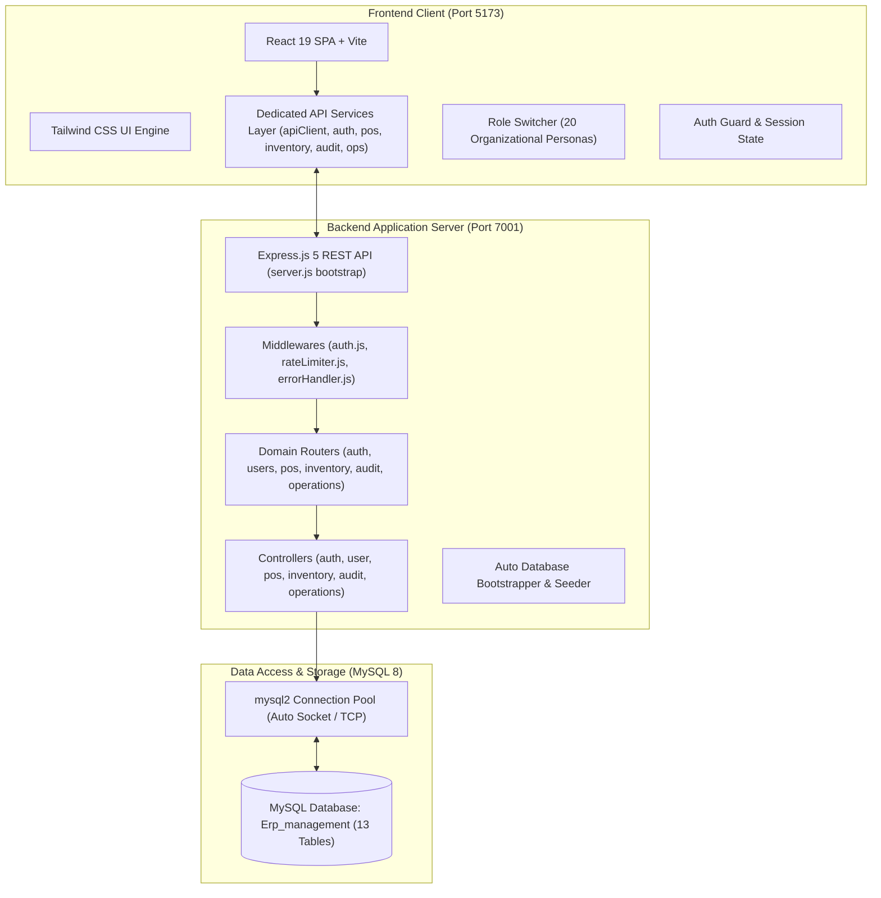
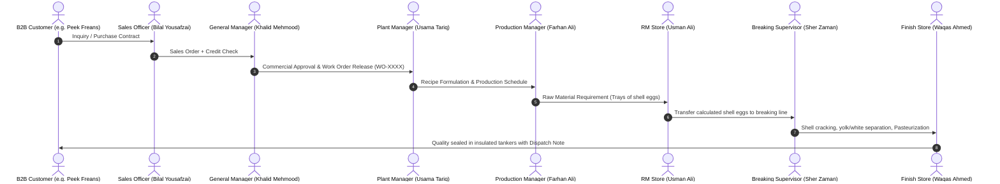
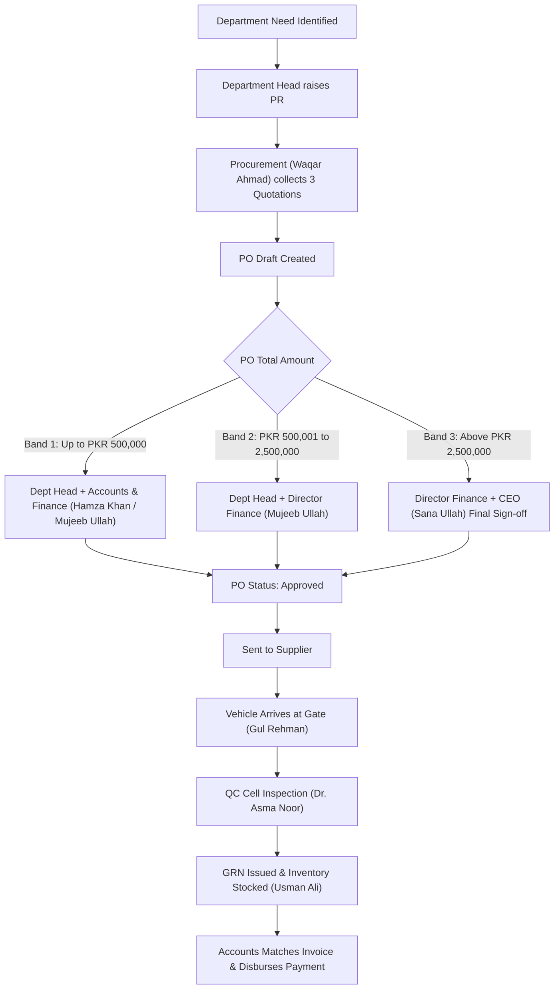

# System Architecture — AgenTech ERP (Yousafzai Agri Foods)

This document provides a comprehensive technical and functional architecture blueprint for **AgenTech ERP**, designed for **Yousafzai Agri Foods (Pvt) Ltd** (Head Office: Mardan, Processing Plant: Rashakai, Layer Farms: Charsadda / Swabi / Haripur).

---

## 1. High-Level System Architecture

The application is structured as an enterprise-grade **Client-Server 3-Tier Architecture** consisting of a React Single-Page Application (SPA) with a dedicated Service Layer, a modular RESTful Express.js backend with Model-View-Controller (MVC) separation, and a relational MySQL database with ACID transactions and pessimistic concurrency locking.

---

## 2. Component Hierarchy & Layer Breakdown

### 2.1 Presentation & Service Layer (Frontend)
- **Framework**: React 19 with Vite 8.
- **Styling**: Tailwind CSS v4 with dark agriculture enterprise theme (`#0E2118` deep spruce green, `#132C20` forest green, and gold/amber accents).
- **Icons**: `lucide-react`.
- **Dedicated Service Layer (`src/services/`)**:
  - `apiClient.js`: Centralized fetch client with automatic JWT token attachment, standard error interception, and JSON serialization.
  - `authService.js`: User login, registration, password update, and session validation.
  - `userService.js`: User listing, admin creation, status toggling, and password reset.
  - `posService.js`: POS counter inventory retrieval, today's sales KPIs, historical invoice lookup, and atomic checkout.
  - `inventoryService.js`: Multi-warehouse stock tracking, physical adjustments, inter-warehouse transfers, and immutable transaction ledger.
  - `auditService.js`: Security and compliance audit log querying, filtering, pagination, Excel/PDF extraction, and client-side event logging.
  - `operationsService.js`: Parallel dataset bootstrapping, workflow approvals, gate passes, POs, production Kanban, and sales credit exceptions.
- **Navigation & Views**:
  - **Overview**: `ChairmanDashboard.jsx`, `ApprovalsInbox.jsx`, `LiveOperations.jsx`, `ProcessMap.jsx`.
  - **Operations**: `ProcurementView.jsx`, `GateSecurity.jsx`, `QcGoodsReceipt.jsx`, `InventoryView.jsx`, `ProductionBoard.jsx`.
  - **Sales & Point of Sale**: `PosView.jsx`, `SalesCreditView.jsx`, `MarketingView.jsx`.
  - **Governance & Audit**: `AuditLogsView.jsx`, `UserManagement.jsx`.
  - **People & Finance**: `PayrollView.jsx`, `FinanceView.jsx`, `ReportsView.jsx`, `SettingsMatrix.jsx`.
- **Security & Multi-Role Simulation**:
  - `Auth.jsx`: Login and Registration interface with rate-limit protection alert banner.
  - `RoleSwitcherModal.jsx`: Allows instant switching between any of the 20 organizational staff roles in real-time.

### 2.2 Modular Application & Business Logic Layer (Backend)
- **Runtime**: Node.js (v22 LTS).
- **Architecture**: Modular MVC with decoupled routes, controllers, and middlewares.
- **Middlewares (`backend/middlewares/`)**:
  - `auth.js`: JWT token verification (`authenticateToken`), admin privileges enforcement (`requireAdmin`), and optional user context extractor (`optionalUserExtractor`).
  - `rateLimiter.js`: General API rate limiting (1000/15min), auth rate limiting (10/15min brute-force shield), and password reset limiting (5/15min).
  - `errorHandler.js`: Centralized unhandled exception handler and 404 router.
- **Controllers (`backend/controllers/`)**:
  - `auth.controller.js`: User registration, bcrypt authentication, password updating, and session verification.
  - `user.controller.js`: Sanitized user retrieval (passwords stripped), admin user creation, profile update, status toggle (`active`/`suspended`), and password reset.
  - `pos.controller.js`: High-performance checkout with ACID transactions, pessimistic locking (`SELECT ... FOR UPDATE`), invoice generation, and sales KPI aggregations.
  - `inventory.controller.js`: Multi-warehouse stock queries across 6 facilities (`MRD`, `ATK`, `CCF`, `PHF`, `RSK_RM`, `RSK_FG`), physical stock adjustment, inter-warehouse transfer with automatic Outward Gate Pass (`GPO-2026-xxx`), and double-entry movement ledger.
  - `audit.controller.js`: Central audit logging, filtered queries, pagination, and multi-format reporting.
  - `operations.controller.js`: Executive KPIs, approval workflows, live plant control room, procurement POs, production Kanban, and monthly payroll batches.
- **Routes (`backend/routes/`)**:
  - `auth.routes.js`: `/api/auth/*`
  - `user.routes.js`: `/api/users/*`
  - `pos.routes.js`: `/api/pos/*`
  - `inventory.routes.js`: `/api/inventory/*`
  - `audit.routes.js`: `/api/audit-logs/*`
  - `operations.routes.js`: `/api/*`
  - `index.js`: Main routing aggregator.
- **Server Bootstrap (`backend/server.js`)**: Clean ~60-line bootstrap file mounting middlewares, routers, and database connection.

### 2.3 Persistence Layer (Database)
- **Engine**: MySQL 8.
- **Connection Adapter**: `backend/config/db.js` utilizing `mysql2/promise` with auto-negotiation for Unix domain sockets (`/opt/local/var/run/mysql8/mysqld.sock`) or TCP host/port.
- **Bootstrapper**: `backend/initDb.js` creates schema tables and seeds initial business data if empty.

---

## 3. Database Entity-Relationship Model (13 Core Tables)

```mermaid
erDiagram
    users ||--o{ workflow_tasks : "assigned to"
    users ||--o{ purchase_orders : "created by"
    users ||--o{ sales_orders : "created by"
    users ||--o{ payroll_runs : "prepared by"
    users ||--o{ audit_logs : "performed by"
    inventory_items ||--o{ pos_order_items : "sold as"
    inventory_items ||--o{ inventory_transactions : "audited by"
    pos_orders ||--o{ pos_order_items : "contains"
    
    users {
        int id PK
        string name
        string role
        string department
        string avatar
        string email
        string password
        string status
    }

    pos_orders {
        int id PK
        string invoice_no UK
        string customer_name
        string customer_phone
        string warehouse
        decimal subtotal
        decimal tax_amount
        decimal discount_amount
        decimal total_amount
        decimal paid_amount
        decimal change_amount
        string payment_method
        string cashier_name
        string status
        timestamp created_at
    }

    pos_order_items {
        int id PK
        int order_id FK
        int item_id FK
        string item_code
        string item_name
        int quantity
        decimal unit_price
        decimal total_price
    }

    inventory_transactions {
        int id PK
        int item_id FK
        string ref_no
        string transaction_type
        int quantity_change
        int prev_qty
        int new_qty
        string warehouse
        string performed_by
        timestamp created_at
    }

    audit_logs {
        int id PK
        int user_id
        string user_name
        string role
        string action
        string entity_type
        string entity_id
        text details
        string ip_address
        string status
        timestamp created_at
    }

    inventory_items {
        int id PK
        string code UK
        string name
        string category
        int mrd_qty
        int atk_qty
        int ccf_qty
        int phf_qty
        int rsk_rm_qty
        int rsk_fg_qty
        int total_qty
        int reorder_at
        decimal avg_cost
        decimal total_value
        string cover_days
        string status
    }

    gate_passes {
        int id PK
        string pass_number UK
        string vehicle_number
        string supplier_customer
        string pass_type
        string since_time
        string status
        timestamp created_at
    }

    workflow_tasks {
        int id PK
        string doc_number UK
        string doc_type
        string title
        string party
        decimal amount
        string priority
        string action_label
        string waiting_since
        string status
        string assigned_role
        timestamp created_at
    }

    purchase_orders {
        int id PK
        string po_number UK
        string po_date
        string supplier
        string status
        string created_by
        decimal amount
        int items_count
        timestamp created_at
    }

    production_orders {
        int id PK
        string wo_number UK
        string stage
        string customer
        string product_name
        decimal quantity_kg
        int eggs_to_break
        int trays_count
        string due_date
        decimal duration_hours
        string priority
        decimal cost_per_kg
        string status
        timestamp created_at
    }

    sales_orders {
        int id PK
        string so_number UK
        string order_date
        string delivery_date
        string customer
        string warehouse
        decimal total_amount
        decimal credit_limit
        decimal current_exposure
        decimal credit_breach
        string status
        string approval_step
        string created_by
    }

    marketing_campaigns {
        int id PK
        string code UK
        string title
        string dates
        string status
        decimal budget
        decimal spent
        string reach
        string engagement
        int leads
        string creatives
        int posts
    }

    payroll_runs {
        int id PK
        string run_number UK
        string run_date
        string month
        string status
        string prepared_by
        decimal net_pay
    }
```

---

## 4. End-to-End Operational Pipelines

### 4.1 Liquid Egg Plant Production Workflow (Rashakai Plant)

---

### 4.2 Tiered Procurement Approval Matrix

---

## 5. Security & Multi-Role Authorization Matrix

The ERP implements a **20-Persona Role Hierarchy** mapping directly to corporate operations:

| Department | Key Roles | Responsibilities |
| :--- | :--- | :--- |
| **Executive** | Chairman & CEO, General Manager | Strategic KPIs, Band 3 PO sign-off, credit breach approvals, payroll sign-off |
| **Operations** | Director Operations, Plant Manager, Production Manager | Plant scheduling, recipe formulation, machine throughput |
| **Plant & Breaking** | Breaking Supervisor | Shell egg cracking, pasteurization, temperature & yield logs |
| **Gate & Logistics** | Gate Officer, Finish Store & Delivery | Inward/outward vehicle gate passes, delivery dispatches |
| **Quality Control** | QC Cell (Dr. Asma Noor) | Egg quality tests (cracks %, weight, Haugh unit), GRN approvals |
| **Inventory** | Raw Material Store | Shell egg reception, tray counts, packaging stock, issue to plant |
| **Procurement** | Procurement Officer | Requisition processing, 3-quote comparisons, PO generation |
| **Sales & Marketing**| Sales Manager, Sales Officer, Head of Marketing | Customer orders, credit limit tracking, brand campaigns |
| **Finance & HR** | Director Finance, Accounts Officer, HR Manager | Receivables aging, invoice 3-way matching, payroll runs |
| **IT & Admin** | ERP Admin | System administration, user onboarding, role permission matrix |

---

## 6. Runtime Configuration & Environment Parameters

| Parameter | Default | Purpose |
| :--- | :--- | :--- |
| `PORT` | `7001` | Backend Express listening port (avoiding macOS port 7000 AirPlay Receiver conflict) |
| `NODE_ENV` | `development` | Environment mode |
| `DB_HOST` | `localhost` | MySQL hostname |
| `DB_PORT` | `3306` | MySQL TCP port |
| `DB_USER` | `root` | MySQL user |
| `DB_PASSWORD`| *(empty)* | MySQL password |
| `DB_NAME` | `Erp_management`| Database schema |
| `VITE_API_URL`| `http://localhost:7001`| Frontend base URL for API queries |
